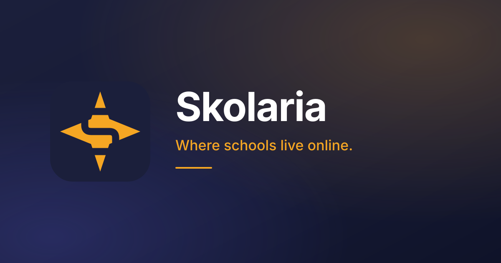
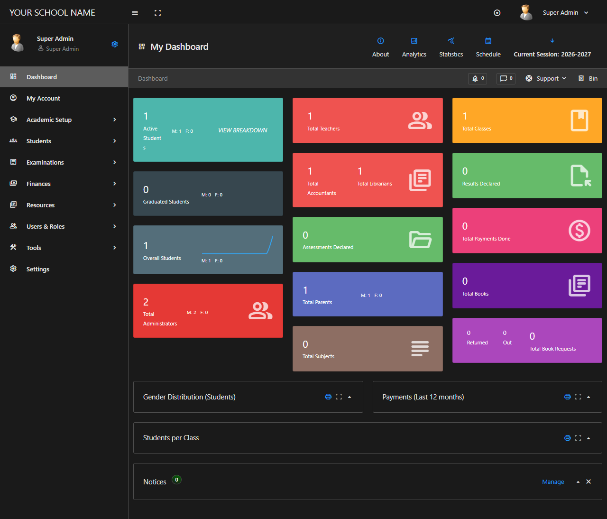

<p align="center"><a href="https://github.com/rayusamBoy/skolaria" target="_blank"></a></p>

<div align="center">

[](https://github.com/rayusamBoy/skolaria/blob/main/LICENSE) [](https://github.com/rayusamBoy/skolaria/issues) [](https://github.com/rayusamBoy/skolaria/graphs/contributors) [](https://github.com/rayusamBoy/skolaria/commits) [](https://github.com/rayusamBoy/skolaria)

</div>

## About

The multi‑tenant, progressive web app (PWA) school management system powered by
[Laravel 13](https://laravel.com), [Bootstrap 4](https://getbootstrap.com),
[jQuery 3](https://jquery.com), and the
[tenancyforlaravel package v4](https://v4.tenancyforlaravel.com), among others.

This project provides a scalable, maintainable School Management System SaaS
platform where each institution (tenant) has fully isolated data while sharing
the same core codebase. Contributors are welcome to help improve features,
fix issues, and enhance overall code quality.

---

## Quick Start

> Run these commands to launch the app locally (you must have PHP, Composer, Node.js, and SQLite):

```bash
# 1. Clone repository
git clone https://github.com/rayusamBoy/skolaria.git

# 2. Navigate into project
cd skolaria

# 3. Install PHP dependencies
composer install

# 4. Install JS dependencies
npm install

# 5. Build frontend assets
npm run build

# 6. Prepare database
cp .env.example .env
php artisan key:generate
php artisan storage:link
php artisan database:ensure-sqlite
php artisan migrate --seed --seeder=DatabaseSeederNonTenancy

# 7. Serve locally
php artisan serve
```

> For full setup instructions, see [Installation](https://github.com/rayusamBoy/skolaria?tab=readme-ov-file#installation).

## Getting Started

### Features

<details>

<summary>Details</summary>

- Tenancy capability (multi‑tenant)
- Progressive Web App (PWA) – offline access, installable
- Light / dark colour modes with multiple theme skins
- Built-in messaging, notifications, and support tickets
- A Root account that manages non‑tenant (central) operations
- Seven tenant roles managed entirely through permissions:
  - `Super admin`, `Admin`, `Teacher`, `Student`, `Parent`, `Accountant`, `Librarian`
    - Each role has a predefined set of permissions (configurable via seeders)
    - Root roles bypass all permission checks
- And much more

</details>

#### Screenshots


`Non-tenancy` [more central screenshots](/public/images/screenshots/non_tenancy/).

---




`Tenancy` [more tenant screenshots](/public/images/screenshots/tenancy/).

#### Prerequisites

- [composer](https://getcomposer.org/) >= 2.9.1
- [npm](https://www.npmjs.com/) >= 11.6.1
- PHP >= 8.4
- Required PHP extensions: Ctype, cURL, DOM, Fileinfo, Filter, Hash,
  Mbstring, OpenSSL, PCRE, PDO, Session, Tokenizer, XML

#### Installation

1. Clone this repository, or you can download the [**zip**](https://github.com/rayusamBoy/skolaria/archive/refs/heads/main.zip) folder instead.

    ```bash
    git clone https://github.com/rayusamBoy/skolaria.git
    ```

2. Change to the app installation directory.

    ```bash
    cd skolaria
    ```

3. Install the Composer dependencies.

    ```bash
    composer install
    ```

4. Install then build the Node packages.

    ```bash
    npm install
    ```

    ```bash
    npm run build
    ```

5. Create a `.env` file by copying the `.env.example` file.

    ```bash
    cp .env.example .env
    ```

6. Generate the `APP_KEY` by running the following command:

    ```bash
    php artisan key:generate
    ```

7. Generate the storage symlink.

    ```bash
    php artisan storage:link
    ```

8. Preparing the database

    `.env`: ensure you copied `.env.example` to `.env` and set the following:

    * `BROADCAST_CONNECTION` - default: `reverb`. You can also use `pusher`. For `pusher`, set the `PUSHER_*` keys and activate the credentials [in this file](resources/js/bootstrap.js).
    * `APP_URL` - your full application URL (e.g. `http://localhost:8000`).
    * `VITE_VAPID_KEY` - **(optional)**. Firebase Cloud Messaging (FCM) push services access token. [How to obtain a key](https://firebase.google.com/docs/cloud-messaging).

    These control the database connection used by Laravel and the tenancy package. You can skip these configurations unless you use connection other than the default `sqlite`. For     the default connection `sqlite` you must run:

    ```bash
        php artisan database:ensure-sqlite
    ```

    Database connection (default: SQLite). For a different driver, refer to the `connections` section of `config/database.php`.

    * `DB_CONNECTION` - default: `sqlite`.
    * `DB_HOST` and `DB_PORT` (if applicable).
    * `DB_DATABASE` - database name (create it first for central).
    * `DB_USERNAME` - database username.
    * `DB_PASSWORD` - database password.

    **Central vs Tenant databases:**

    * This project uses the `stancl/tenancy` package. The central application (system-wide data and tenant management) uses the database defined by your `DB_*` env settings.
    * Tenant databases are managed by the tenancy package. Tenant database naming and creation are controlled in `config/tenancy.php` (see the `database` section). By default tenant DB names use the configured `prefix` + tenant id + `suffix`.

    **Creating tenant databases:**

    * After central migrations and seeders, you can create tenants (and their domains) from the central UI. The tenancy package will create tenant databases (and run all other operations like migrations, seeding, etc) automatically using the configured tenant database manager (MySQL, SQLite, or Postgres) when a tenant is provisioned.
    * If you prefer to provision tenants via Artisan or Tinker, refer to the [stancl/tenancy documentation](https://v4.tenancyforlaravel.com/).

    **Common Issues & Troubleshooting**

    Database connection refused / Access denied:

    * Verify your `DB_HOST`, `DB_PORT`, `DB_DATABASE`, `DB_USERNAME`, and `DB_PASSWORD` values in `.env` and that the database server is reachable.
    * Ensure the DB user has privileges to create databases if you rely on the tenancy package to create tenant databases automatically.
        
    Tenant migrations not running / empty tenant schema:
        
    * Ensure tenants were created successfully in the central app.
    * Check `config/tenancy.php` `database.managers` and `prefix`/`suffix` to confirm tenant DB naming and manager behavior.

    Central/tenant domain routing issues:
        
    * If you are using a custom central domain (not `localhost`), re-check the `APP_URL` and make sure it matches your domain. If you are using more than one central domains add      it to `config/tenancy.php` → `central_domains`.
    * When testing locally with tenant domains, ensure your domains ends with `localhost:8000`, e.g. `foo.localhost:8000`.
    
    Storage & permissions errors:
    
    * Ensure `storage/` and `bootstrap/cache` are writable by the webserver user. Run `php artisan storage:link` after migrations to create the public storage symlink.

9.  Migrate the database.

    > Before running migrations make sure your environment is configured correctly.

    ```bash
    php artisan migrate
    ```

10. Seed the database.

    ```bash
    php artisan db:seed --class=DatabaseSeederNonTenancy
    ```

    if you get an error like this: `Insufficient memory limit detected! Current: 128M, Recommended: 512M`
    then increase your PHP memory limit in `php.ini` file and restart your server.
    Or run the command with the increased memory limit:

    ```bash
    php -d memory_limit=512M artisan db:seed --class=DatabaseSeederNonTenancy
    ```

11. **(optional)** If you have set the optional value for `VITE_VAPID_KEY`, you must also configure the Firebase [in this file](public/assets/js/firebase-config.js) and provide the Firebase service account credentials [in this file](storage/app/firebase/service-account-credentials.json). The app will work perfectly fine even if you do not set these values.
    After changing these values, rebuild assets: `npm run build`

12. **(optional)** Start the Reverb server:

    ```bash
    php artisan reverb:start
    ```

> [!IMPORTANT]
> Any time you change a `VITE_*` environment variable or the
> `BROADCAST_CONNECTION`, you must rebuild the Node packages:
>
> ```bash
> npm run build
> ```

## Usage & Deployment

### Development

Open a new terminal, then serve the `app` and access it via url `http://localhost:8000` by running:

```bash
php artisan serve
```

### Deployment

Please review the official [Laravel deployment guide](https://laravel.com/docs/13.x/deployment), and consider searching online for tutorials on deploying a Laravel application tailored to your specific hosting environment.

### Usage

1. Central app scope

    After installation, access the central app via the already running URL `http://localhost:8000` using.

    | Account Type | Username   | Email              | Password |
    | ------------ | ---------- | ------------------ | -------- |
    | Root         | `rootuser` | `rootuser@sms.com` | `root`   |

> [!IMPORTANT]
>
> When using a central domain other than `localhost` (e.g., `sms.edu`):
>
> Set it as the `APP_URL`. If you have more than one central domain, add them to config/tenancy.php → central_domains:
>
> ```php
> 'identification' => [
>      /**
>      * The list of domains hosting your central app.
>      *
>      * Only relevant if you're using the domain or subdomain identification middleware.
>      */
>      'central_domains' => [
>         str(env('APP_URL'))->after('://')->before('/')->before(':')->toString(),
>         sms.edu, // Add you central domain here
>      ],
>  ...
>
> ```

1. Tenant app scope

    Create a tenant and its domain via the central UI. Then use that domain to log in with any of the following seeded accounts:

    | Account Type | Username     | Email                | Password     |
    | ------------ | ------------ | -------------------- | ------------ |
    | Super Admin  | `superadmin` | `superadmin@sms.com` | `superadmin` |
    | Admin        | `admin`      | `admin@sms.com`      | `admin`      |
    | Teacher      | `teacher`    | `teacher@sms.com`    | `teacher`    |
    | Parent       | `parent`     | `parent@sms.com`     | `parent`     |
    | Accountant   | `accountant` | `accountant@sms.com` | `accountant` |
    | Librarian    | `librarian`  | `librarian@sms.com`  | `librarian`  |
    | Student      | `student`    | `student@sms.com`    | `student`    |

> [!NOTE]
> For more information please refer to the [stancl/tenancy documentation](https://v4.tenancyforlaravel.com).

## Contributing

Please see [contributing](https://github.com/rayusamBoy/skolaria/blob/main/CONTRIBUTING.md) for details. If you find this project useful, consider starring it on GitHub!

## Acknowledgement

This project is based on the [lav_sms](https://github.com/4jean/lav_sms) project by [4jean](https://github.com/4jean). I would like to express my sincere gratitude to 4jean, to everyone whose code was used, and to all contributors.

## License

The School Management System is open-sourced software licensed under the [MIT License](https://github.com/rayusamBoy/skolaria/blob/main/LICENSE).
