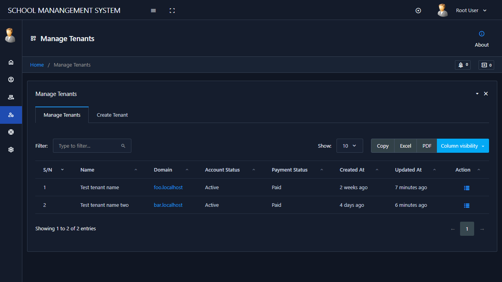
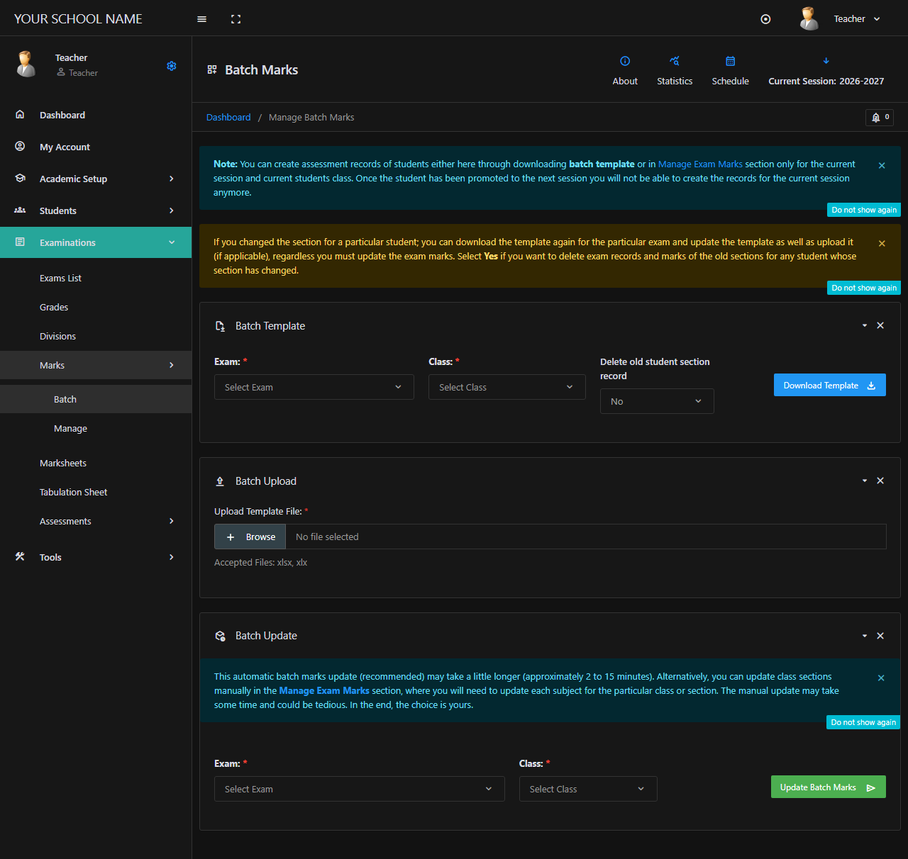

<p align="center">
  <a href="https://github.com/rayusamBoy/skolaria">
    
  </a>
</p>

<div align="center">

[](https://github.com/rayusamBoy/skolaria/blob/main/LICENSE)
[](https://github.com/rayusamBoy/skolaria/issues)
[](https://github.com/rayusamBoy/skolaria/graphs/contributors)
[](https://github.com/rayusamBoy/skolaria/commits)
[](https://github.com/rayusamBoy/skolaria)

</div>

# Skolaria – School Management System

## About

**Skolaria** is a multi-tenant, Progressive Web App (PWA) School Management System powered by [Laravel 13](https://laravel.com), [Bootstrap 4](https://getbootstrap.com), [jQuery 3](https://jquery.com), and [Tenancy for Laravel v4](https://v4.tenancyforlaravel.com), among other technologies.

It provides a scalable and maintainable School Management System SaaS platform where multiple educational institutions operate independently while sharing the same core application and codebase.

### Built for Multi-School Entities

Beyond standard SaaS multi-tenancy, Skolaria is designed to support organizations managing multiple school branches.

For example:

- Peaceschool Academy – Main Campus
- Peaceschool Academy – North Branch
- Peaceschool Academy – South Branch

Using `request_data` tenant identification and secure user impersonation, administrators can seamlessly switch between schools without requiring different domains or subdomains.

Additionally, the built-in **Master Data Synchronization** service allows administrators to configure academic structures such as grades, divisions, subjects, and examination categories once and synchronize them across multiple schools.

### Permission and Authorization

Skolaria uses a custom permission and authorization package, **`laravel-permission-kit`**, developed as part of the project.

The package source code is available within this repository:

[`packages/laravel-permission-kit`](https://github.com/rayusamBoy/skolaria/tree/main/packages/laravel-permission-kit)

> **Development status:** `laravel-permission-kit` is currently in its initial development stage. Although its source code is publicly accessible as part of the Skolaria repository, it has not yet been officially released as an independent Composer package. A standalone Composer release will be considered once the package has matured and is ready for wider adoption.

---

## Features

<details>
<summary><strong>View all features</strong></summary>

### Multi-Tenancy and School Management

- **Multi-School / Multi-Branch Support:** Manage multiple schools from a central context.
- **Seamless School Switching:** Switch between schools using request-data tenant identification without changing domains.
- **Secure Impersonation:** Securely access and manage individual tenant environments.
- **Tenant Data Isolation:** Maintain independent data for each school or branch.

### Master Data Management

- **Master Data Synchronization:** Synchronize academic structures across multiple school branches.
- **Centralized Configuration:** Configure classes, sections, subjects, grades, and divisions once.
- **Master Data Locking:** Prevent local administrators from modifying standardized configurations through `locked_master_tables`.

### Application Features

- **Progressive Web App (PWA):** Installable application with offline capabilities.
- **Role and Permission Management:** Custom authorization functionality powered by `laravel-permission-kit`.
- **Light and Dark Modes:** Multiple theme skins with customizable appearance.
- **Messaging and Notifications:** Built-in communication and notification functionality.
- **Support Tickets:** Integrated support ticket management system.

</details>

---

## Screenshots

### Central Application (Non-Tenancy)

<p align="center">
&#x20; 
&#x20; 
</p>

### Tenant Application (Tenancy)

<p align="center">
&#x20; 
&#x20; 
</p>

---

## Requirements

Ensure the following software and dependencies are installed before proceeding.

| Dependency | Minimum Version                    |
| ---------- | ---------------------------------- |
| PHP        | 8.4                                |
| Composer   | 2.9.1                              |
| Node.js    | Compatible with npm 11.6.1         |
| npm        | 11.6.1                             |
| Database   | SQLite (for the quick-start setup) |

### Required PHP Extensions

- Ctype
- cURL
- DOM
- Fileinfo
- Filter
- Hash
- Mbstring
- OpenSSL
- PCRE
- PDO
- Session
- Tokenizer
- XML

---

## Quick Start

Follow these steps to run Skolaria locally.

### 1. Clone the Repository

```bash
git clone https://github.com/rayusamBoy/skolaria.git
cd skolaria
```

### 2. Install Dependencies

Install PHP dependencies:

```bash
composer install
```

Install JavaScript dependencies:

```bash
npm install
```

### 3. Build Frontend Assets

```bash
npm run build
```

### 4. Configure the Environment

Create your environment file:

```bash
cp .env.example .env
```

Generate the application key:

```bash
php artisan key:generate
```

Create the storage symbolic link:

```bash
php artisan storage:link
```

### 5. Prepare the Database

For the default SQLite setup:

```bash
php artisan database:ensure-sqlite
```

Run migrations and seed the initial central application data:

```bash
php artisan migrate --seed --seeder=DatabaseSeederNonTenancy
```

### 6. Start the Application

```bash
php artisan serve
```

Access the application at:

```text
http://localhost:8000
```

For complete installation and configuration details, see [Installation](#installation).

---

## Installation

### 1. Clone the Repository

```bash
git clone https://github.com/rayusamBoy/skolaria.git
cd skolaria
```

### 2. Install Composer Dependencies

```bash
composer install
```

### 3. Install and Build Frontend Dependencies

```bash
npm install
npm run build
```

### 4. Configure Environment Variables

Copy the example environment file:

```bash
cp .env.example .env
```

Generate the application encryption key:

```bash
php artisan key:generate
```

Create the storage symbolic link:

```bash
php artisan storage:link
```

### 5. Configure Application Settings

Update your `.env` file according to your environment.

Important configuration variables include:

| Variable               | Description                                                             |
| ---------------------- | ----------------------------------------------------------------------- |
| `APP_URL`              | Full application URL, e.g. `http://localhost:8000`.                     |
| `BROADCAST_CONNECTION` | Broadcasting driver. Defaults to Reverb; Pusher can also be configured. |
| `VITE_VAPID_KEY`       | Optional VAPID public key for web push notifications. [How to obtain a key](https://firebase.google.com/docs/cloud-messaging) |

### 6. Configure the Database

Skolaria supports a central database and separate tenant databases.

Tenant database creation and naming are managed by the tenancy package and configured in:

```text
config/tenancy.php
```

For the default SQLite development environment:

```bash
php artisan database:ensure-sqlite
```

Run migrations:

```bash
php artisan migrate
```

Seed the central application:

```bash
php artisan db:seed --class=DatabaseSeederNonTenancy
```

### 7. Configure Notifications and Broadcasting (Optional)

1. **Firebase Push Notifications:** If you set `VITE_VAPID_KEY` in your `.env` file, configure Firebase in `public/assets/js/firebase-config.js` and add your service account credentials to `storage/app/firebase/service-account-credentials.json`.

   Firebase is optional; the application works without it.

2. **Rebuild assets** after configuring Firebase:

   ```bash
   npm run build

To start the Laravel Reverb WebSocket server:

```bash
php artisan reverb:start
```

---

## Deep Dive: Multi-School Architecture

Skolaria supports two distinct tenant identification modes configured through `config/tenancy.php`.

### 1. Domain Identification

Each school is accessed through its own domain or subdomain.

For example:

```text
school1.skolaria.co.tz
school2.skolaria.co.tz
school3.skolaria.co.tz
```

The tenancy package identifies and initializes the appropriate tenant based on the requested domain.

### 2. Request Data Identification

Recommended for multi-school organizations managing several branches.

All schools can be accessed through a single application URL. The active tenant is identified using request data, with a secure cookie tracking the currently selected school.

For example:

```text
https://school.skolaria.co.tz
```

This approach allows central administrators to switch between schools without changing domains or subdomains.

---

## Seamless School Impersonation

When using `request_data` identification mode, central administrators can seamlessly switch between tenant environments.

The `UserImpersonationController` generates a secure impersonation token and establishes the tenant context through a cookie.

Example:

```php
if (config('tenancy.active_identification_mode') === 'request_data') {
    return redirect("/impersonate/{$token->token}")->withCookie(
        Cookie::make('tenant', $tenant->id, 120)
    );
}
```

This allows administrators to access and manage different schools through a single application interface.

---

## Master Data Synchronization

Managing academic configurations independently across multiple school branches can be time-consuming and prone to inconsistencies.

Skolaria addresses this challenge through the `SyncMasterDataService`.

Administrators can:

1. Select a source school.
2. Select one or more target schools.
3. Choose the master data to synchronize.
4. Push the selected configurations to the target schools.

### Why Is This Useful?

Consider an organization operating ten school branches that all use the same grading system:

| Grade | Score Range |
| ----- | ----------- |
| A     | 80–100      |
| B     | 70–79       |
| C     | 60–69       |
| D     | 50–59       |
| F     | 0–49        |

Instead of configuring the grading system independently in all ten schools, the administrator configures it once in the main branch and synchronizes it with the remaining nine branches.

### Supported Master Data

The synchronization service supports academic structures including:

- Classes
- Sections
- Subjects
- Grades
- Divisions
- Examination categories

### Master Data Locking

The service also supports locking selected master data tables in target tenants through:

```php
locked_master_tables
```

This prevents local administrators from accidentally modifying standardized configurations established by the central organization.

---

## Getting Started

Skolaria provides two application scopes: Central and Tenant.

### 1. Central Application Scope

After installation, access the central application:

```text
http://localhost:8000
```

Use the following default account:

| Account Type | Username   | Email              | Password |
| ------------ | ---------- | ------------------ | -------- |
| Root         | `rootuser` | `rootuser@sms.com` | `root`   |

> [!IMPORTANT]
> When using a central domain other than `localhost` (for example, `school.skolaria.co.tz`), update `APP_URL` in your `.env` file or add the domain to `central_domains` in `config/tenancy.php`.

### 2. Tenant Application Scope

Create a tenant and its associated domain through the central application interface.

Once the tenant has been created, access its domain and log in using one of the following seeded accounts.

| Account Type | Username     | Email                | Password     |
| ------------ | ------------ | -------------------- | ------------ |
| Super Admin  | `superadmin` | `superadmin@sms.com` | `superadmin` |
| Admin        | `admin`      | `admin@sms.com`      | `admin`      |
| Teacher      | `teacher`    | `teacher@sms.com`    | `teacher`    |
| Parent       | `parent`     | `parent@sms.com`     | `parent`     |
| Accountant   | `accountant` | `accountant@sms.com` | `accountant` |
| Librarian    | `librarian`  | `librarian@sms.com`  | `librarian`  |
| Student      | `student`    | `student@sms.com`    | `student`    |

> [!WARNING]
> These uses default password credentials. Change them before or shortly after deploying the application to a production environment.

> [!NOTE]
> For additional information about tenancy configuration and management, refer to the [Tenancy for Laravel documentation](https://v4.tenancyforlaravel.com).

---

## Contributing

Contributions are welcome!

If you would like to contribute to Skolaria, please see the project's contributing guidelines.

Whether you are reporting bugs, suggesting improvements, submitting features, or improving documentation, your contributions are appreciated.

If you find this project useful, consider giving it a ⭐ on GitHub.

---

## Acknowledgements

This project is based on the original `lav_sms` project by [4jean](https://github.com/4jean).

I would like to express my sincere gratitude to 4jean, everyone whose code and contributions have helped shape this project, and all other contributors.

---

## License

Skolaria is open-source software licensed under the **GNU Affero General Public License v3.0 (AGPL-3.0)**.

See the [LICENSE](LICENSE) file for more information.

