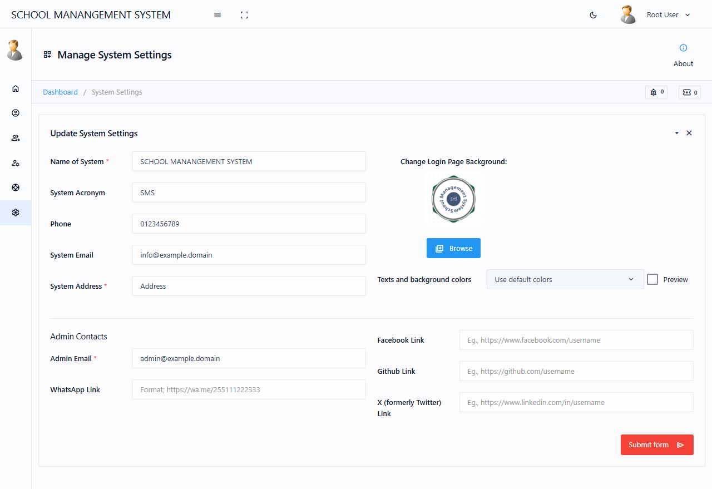

<p align="center"><a href="https://github.com/rayusamBoy/Laravel_tenancy_sms" target="_blank"></a></p>

<div align="center">
    
[](https://github.com/rayusamBoy/Laravel_tenancy_sms/blob/main/LICENSE) [](https://github.com/rayusamBoy/Laravel_tenancy_sms/issues) [](https://github.com/rayusamBoy/Laravel_tenancy_sms/graphs/contributors) [](https://github.com/rayusamBoy/Laravel_tenancy_sms/commits) [](https://github.com/rayusamBoy/Laravel_tenancy_sms)

</div>

## About

A multi-tenant, progressive web app (PWA); school management system powered by technologies including the [Laravel 12 framework](https://laravel.com), [Bootstrap v4.1.1](https://getbootstrap.com), [jQuery v3.3.1](https://jquery.com), and the [tenancyforlaravel package v4](https://v4.tenancyforlaravel.com), among others.

## Quick Start

> Run these commands to launch the app locally:

```bash
# 1. Clone repository
git clone https://github.com/rayusamBoy/Laravel_tenancy_sms.git

# 2. Navigate into project
cd Laravel_tenancy_sms

# 3. Install PHP dependencies
composer install

# 4. Install JS dependencies
npm install

# 5. Build frontend assets
npm run build

# 6. Prepare database
php artisan key:generate
php artisan storage:link
php artisan migrate --seed --seeder=DatabaseSeederNonTenancy

# 7. Serve locally
php artisan serve
```

> For full setup instructions, see [Installation](https://github.com/rayusamBoy/Laravel_tenancy_sms?tab=readme-ov-file#installation).

## Getting Started

### Features

<details>

<summary>Details</summary>

-   Tenancy capability
-   Progressive Web App (PWA) features including Offline access
-   Color modes (dark and light)
-   Built-in messaging, notifications, and support tickets
-   An `IT Guy` account that can manage nont-tenant operations
-   Eight (8) types of user accounts
    -   `Super admin`
        -   Create any user account
        -   Can delete any record
        -   Only can access System Settings, Bin and Activity Log
        -   Manage all notices
        -   Can perform all `Admin` function
        -   Only can create & delete message thread
    -   `Admin`
        -   Create, edit and manage user accounts
        -   Create, edit and manage Subjects, Exams, Assessments, Books, Pins, Query builder etc.
        -   Manage payments
        -   Manage own notices
    -   `Teacher`
        -   Manage own Class and Section
        -   Manage Exam records for own Subjects
        -   Manage timetable if assigned as Class Teacher
        -   Manage own profile
        -   Manage own assessments
    -   `Student`
        -   Manage own profile
        -   View own subjects and results sheets
        -   View own assessments sheets
        -   View library and book status
        -   View notices and school events in calendar
    -   `Parent`
        -   Manage own profile
        -   View, print, download own child's marksheet, assessmentsheet
        -   View own child's timetable
        -   View own child's payments
        -   View notices and school events in calendar
    -   `Accountant`
        -   Manage payments & fees
        -   Print Payments receipts
        -   Manage own profile
        -   Manage own notices on notice board
    -   `Librarian`
        -   Manage library books and book requests.
        -   Manage own profile
    -   `Companion`
        -   Manage own profile
        -   View students
-   Among others.

</details>

#### Screenshots




`Non-tenancy` [more screenshots](/public/images/screenshots/non_tenancy/).

<hr>


`Tenancy` [more screenshots](/public/images/screenshots/tenancy/).

#### Prerequisites

-   [composer](https://getcomposer.org/) >= 2.9.1
-   [npm](https://www.npmjs.com/) >= 11.6.1
-   PHP >= 8.4
-   Ctype PHP Extension
-   cURL PHP Extension
-   DOM PHP Extension
-   Fileinfo PHP Extension
-   Filter PHP Extension
-   Hash PHP Extension
-   Mbstring PHP Extension
-   OpenSSL PHP Extension
-   PCRE PHP Extension
-   PDO PHP Extension
-   Session PHP Extension
-   Tokenizer PHP Extension
-   XML PHP Extension

#### Installation

1. Clone this repository, or you can download the [**zip**](https://github.com/rayusamBoy/Laravel_tenancy_sms/archive/refs/heads/main.zip) folder instead.

    ```bash
    git clone https://github.com/rayusamBoy/Laravel_tenancy_sms.git
    ```

2. Change to the app installation directory.

    ```bash
    cd Laravel_tenancy_sms
    ```

3. Install the Composer dependencies.

    ```bash
    composer install
    ```

4. Install then build the Node packages.

    ```bash
    npm install
    ```

    ```bash
    npm run build
    ```

5. Create a `.env` file by copying the `.env.example` file.

    ```bash
    cp .env.example .env
    ```

6. Generate the `APP_KEY` by running the following command:

    ```bash
    php artisan key:generate
    ```

7. Generate the storage symlink.

    ```bash
    php artisan storage:link
    ```

8. Preparing the database <br/>
   `.env`: ensure you copied `.env.example` to `.env` and set the following:

    - `DB_CONNECTION` - default: `mysql`, `DB_HOST` and `DB_PORT` (if applicable).
    - `DB_DATABASE` - database name (make sure you have created one - you must do only this time for central connection).
    - `DB_USERNAME` - database username.
    - `DB_PASSWORD` - database password.

    > Those above control the database connection used by Laravel and the tenancy package.

    - `BROADCAST_CONNECTION` - default: `reverb`. You can also opt for `pusher`. For `pusher`, make sure to set the appropriate values for any keys that start with `PUSHER_`, then you will need to activate the credentials [in this file](resources/js/bootstrap.js).
    - `APP_URL` - set your app URL (include protocol and port if applicable, for example `http://localhost:8000`).
    - `VITE_VAPID_KEY` - **(optional)**. Firebase Cloud Messaging (FCM) push services access token. To get a key and more [check this out](https://firebase.google.com/docs/cloud-messaging).

    Central vs Tenant databases: <br/>

    - This project uses the `stancl/tenancy` package. The central application (system-wide data and tenant management) uses the database defined by your `DB_*` env settings.
    - Tenant databases are managed by the tenancy package. Tenant database naming and creation are controlled in `config/tenancy.php` (see the `database` section). By default tenant DB names use the configured `prefix` + tenant id + `suffix`.

    Creating tenant databases: <br/>

    - You can create tenants (and their domains) from the central UI in the app after you run the central migrations and seeders. The tenancy package will create tenant databases (and run all other operations like migrations, seeding, etc) automatically using the configured tenant database manager (MySQL, SQLite, or Postgres) when a tenant is provisioned.
    - If you prefer to provision tenants via artisan or tinker, follow the `stancl/tenancy` [documentation](https://v4.tenancyforlaravel.com/).

    #### Common Issues & Troubleshooting

    Database connection refused / Access denied:

    - Verify your `DB_HOST`, `DB_PORT`, `DB_DATABASE`, `DB_USERNAME`, and `DB_PASSWORD` values in `.env` and that the database server is reachable.
    - Ensure the DB user has privileges to create databases if you rely on the tenancy package to create tenant databases automatically.

    Tenant migrations not running / empty tenant schema:

    - Ensure tenants were created successfully in the central app.
    - Check `config/tenancy.php` `database.managers` and `prefix`/`suffix` to confirm tenant DB naming and manager behavior.

    Central/tenant domain routing issues:

    - If you are using a custom central domain (not `localhost`), re-check the `APP_URL` and make sure it matches your domain. If you are using more than one central domains add it to `config/tenancy.php` → `central_domains`.
    - When testing locally with tenant domains, ensure your domains ends with `localhost:8000` like `foo.localhost:8000`.

    Storage & permissions errors:

    - Ensure `storage/` and `bootstrap/cache` are writable by the webserver user. Run `php artisan storage:link` after migrations to create the public storage symlink.
      When you change Vite or broadcast keys:

9. Migrate the database.

    > Before running migrations make sure your environment is configured correctly.

    ```bash
    php artisan migrate
    ```

10. Seed the database.

    ```bash
    php artisan db:seed --class=DatabaseSeederNonTenancy
    ```

11. **(optional)**. If you have set the optional value for `VITE_VAPID_KEY`, you must also configure the Firebase [in this file](public/assets/js/firebase-config.js) and provide the Firebase service account credentials [in this file](storage/app/firebase/service-account-credentials.json). The app will work perfectly fine even if you do not set these values.
12. **(optional)**. If you have set either or both of the options above, you must rebuild the node packages by running:

    ```bash
    npm run build
    ```

13. Start the `reverb` by running:

    ```bash
    php artisan reverb:start
    ```

> [!IMPORTANT]
> Whenever you set or update any value in the `.env` file for keys that start with `VITE_` and/or change the `BROADCAST_CONNECTION`, you must rebuild the node packages by running:
>
> ```bash
> npm run build
> ```

## Usage & Deployment

#### Development

Open a new terminal, then serve the `app` and access it via url `http://localhost:8000` by running:

```bash
php artisan serve
```

#### Deployment

Please review the official [Laravel deployment guide](https://laravel.com/docs/12.x/deployment), and consider searching online for tutorials on deploying a Laravel application tailored to your specific hosting environment.

#### Usage

1. Central app scope <br>
   Once you have completed the installation, you can access the central app via the already running URL `http://localhost:8000` using the following credentials.

    | Account Type | Username | Email           | Password |
    | ------------ | -------- | --------------- | -------- |
    | IT Guy       | `itguy`  | `itguy@sms.com` | `itguy`  |

> [!IMPORTANT]
> When using a central domain other than `localhost` (e.g., `sms.edu`): <br/>
> Set it as the `APP_URL` value as long as you use only one central domain. Otherwise, you can set the main domain as the `APP_URL` and add other domain(s) to the `central_domains` key in the `identification` section of [tenancy configuration file](config/tenancy.php).
>
> ```php
> 'identification' => [
>      /**
>      * The list of domains hosting your central app.
>      *
>      * Only relevant if you're using the domain or subdomain identification middleware.
>      */
>      'central_domains' => [
>         str(env('APP_URL'))->after('://')->before('/')->before(':')->toString(),
>         sms.edu, // Add you central domain here
>      ],
>  ...
>
> ```

1. Tenant app scope <br>
   To access the tenant app, you need to create a tenant and tenant domain via the central app UI.
   Once that's done, you can use the created domain to access the system with the following credentials.

    | Account Type | Username     | Email                | Password     |
    | ------------ | ------------ | -------------------- | ------------ |
    | Super Admin  | `superadmin` | `superadmin@sms.com` | `superadmin` |
    | Admin        | `admin`      | `admin@sms.com`      | `admin`      |
    | Teacher      | `teacher`    | `teacher@sms.com`    | `teacher`    |
    | Companion    | `companion`  | `companion@sms.com`  | `companion`  |
    | Parent       | `parent`     | `parent@sms.com`     | `parent`     |
    | Accountant   | `accountant` | `accountant@sms.com` | `accountant` |
    | Librarian    | `librarian`  | `librarian@sms.com`  | `librarian`  |
    | Student      | `student`    | `student@sms.com`    | `student`    |

> [!NOTE]
> For more information please refer to this [tenancy package documentation](https://v4.tenancyforlaravel.com).

## Contributing

Please see [contributing](https://github.com/rayusamBoy/Laravel_tenancy_sms/blob/main/CONTRIBUTING.md) for details. Also, show your support by at least becoming one of the stargazers (starring this project) if you find it useful, or if any part of it is helpful.

## Acknowledgement

This project is based on the [lav_sms](https://github.com/4jean/lav_sms) project by [4jean](https://github.com/4jean). I would like to express my sincere gratitude to 4jean, to everyone whose code was used, and to all contributors.

## License

The School Management System is open-sourced software licensed under the [MIT License](https://github.com/rayusamBoy/Laravel_tenancy_sms/blob/main/LICENSE).
